# TableTap

**Restaurant ordering, kitchen, POS and operations — one connected system.**

TableTap is a multi-tenant restaurant platform built for Thai restaurants: QR ordering at the
table, a station-routed kitchen display, a cashier POS with PromptPay, bill snapshots, inventory
that deducts from recipes, and analytics computed from real transactions.

It is a working product, not a UI prototype. Every screen calls a real API; every number is a SQL
aggregate over persisted rows. The demo dataset is generated from actual orders, bills and
payments.

```
Guest scans QR ──► Menu & cart ──► Order (server priced, idempotent)
                                        │
                                        â–¼
                              Kitchen tickets by station
                                        │
                    accept → start → item ready → served
                                        │
                                        â–¼
                       Bill snapshot ──► Payment (cash / PromptPay)
                                        │
                                        â–¼
                    Receipt · inventory movements · analytics · audit log
```

---

## Screenshots

| Staff overview                               | Floor plan                                     |
| -------------------------------------------- | ---------------------------------------------- |
| 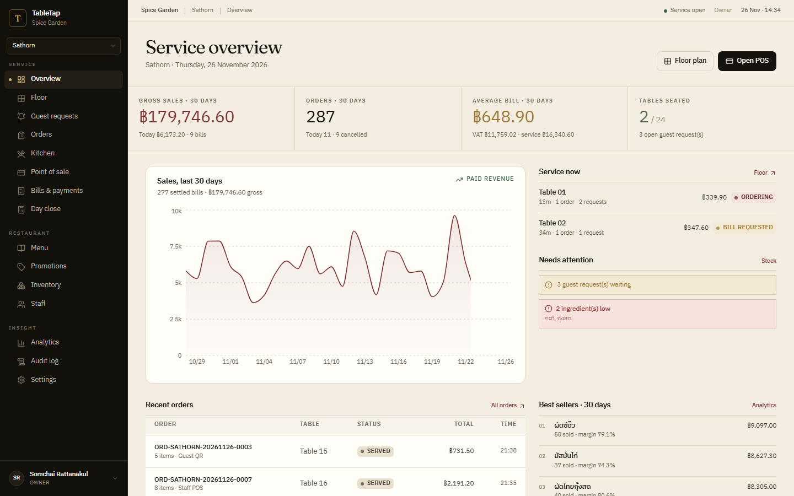 |  |

| Kitchen display                          | POS                              |
| ---------------------------------------- | -------------------------------- |
| 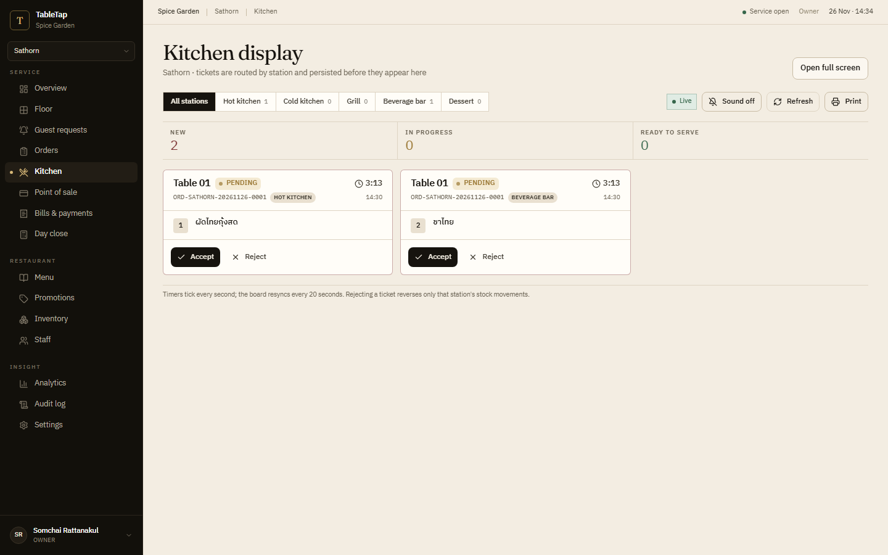 |  |

| Analytics                                    | Menu management                    |
| -------------------------------------------- | ---------------------------------- |
|  | 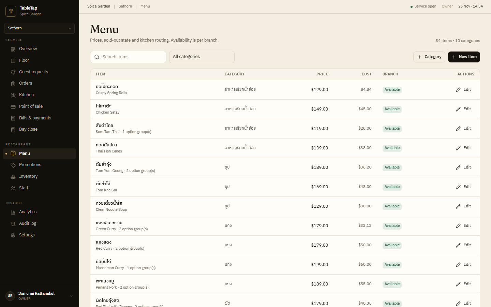 |

| The check                          | Printable receipt                        |
| ---------------------------------- | ---------------------------------------- |
|  |  |

| Guest menu — phone                                  | Staff overview — phone                         |
| ----------------------------------------------------- | ------------------------------------------------ |
|  | 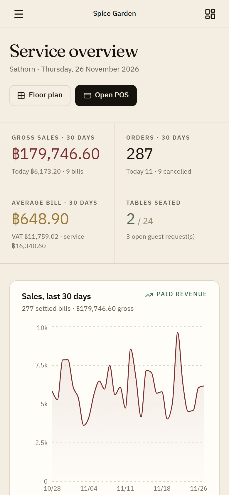 |

| Landing                                  | Sign in                                |
| ---------------------------------------- | -------------------------------------- |
| 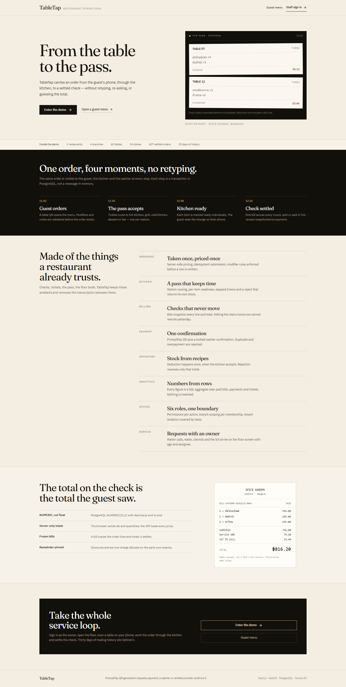 | 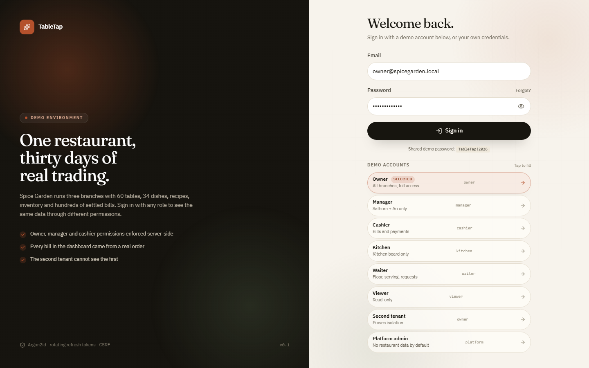 |

| Guest menu — desktop                         | Guest menu — dish sheet                           |
| ---------------------------------------------- | --------------------------------------------------- |
| 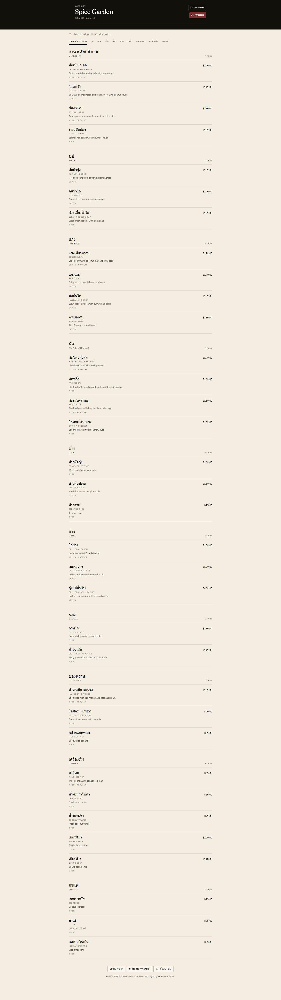 | 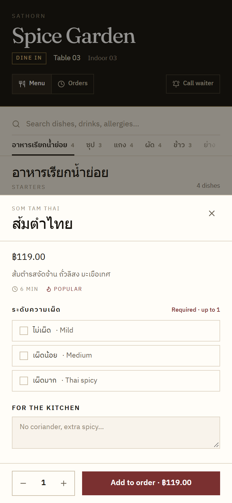 |

| Day close                                    | Promotions                                     |
| -------------------------------------------- | ---------------------------------------------- |
| 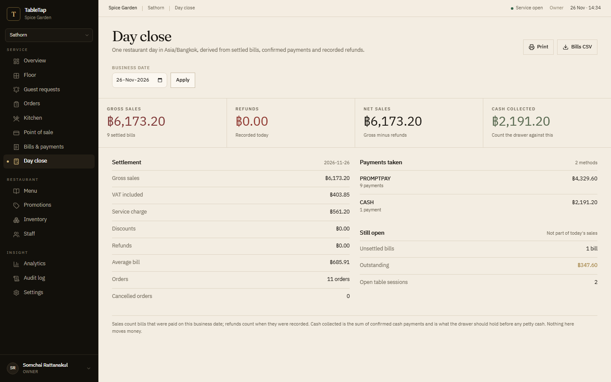 | 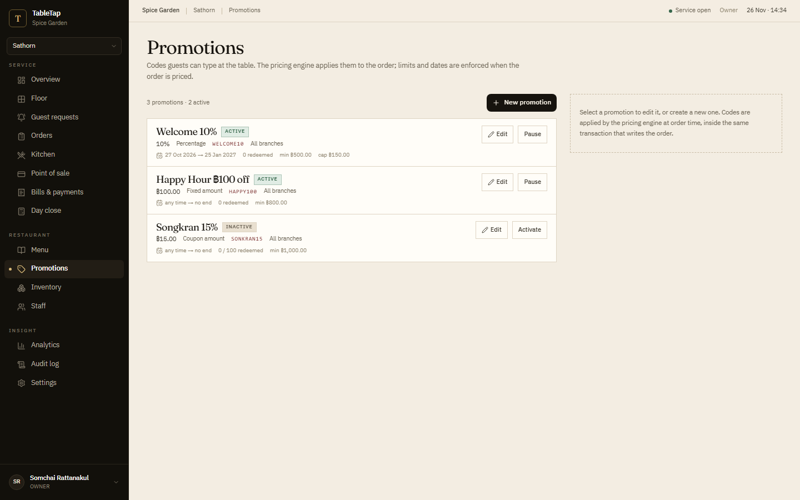 |

| Guest requests                             | Platform administration                    |
| ------------------------------------------ | ------------------------------------------ |
| 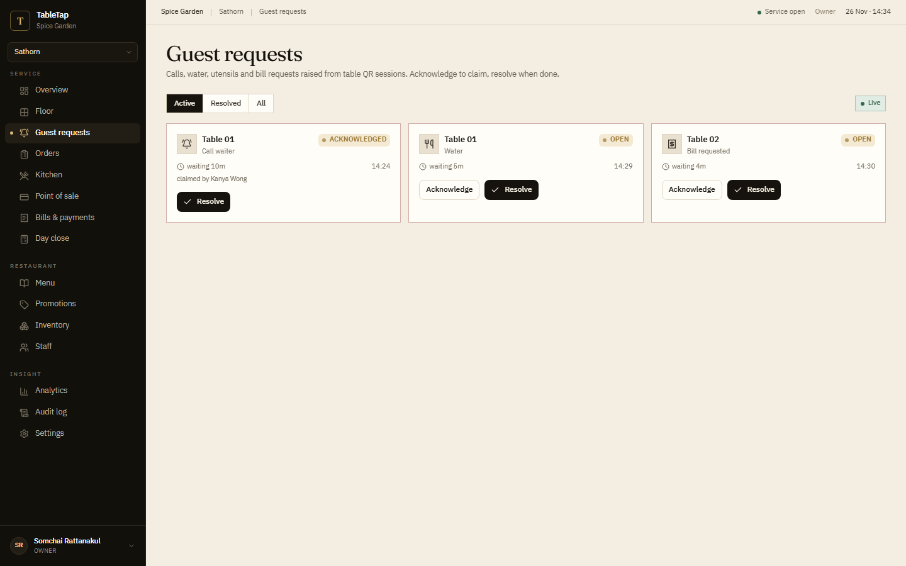 | 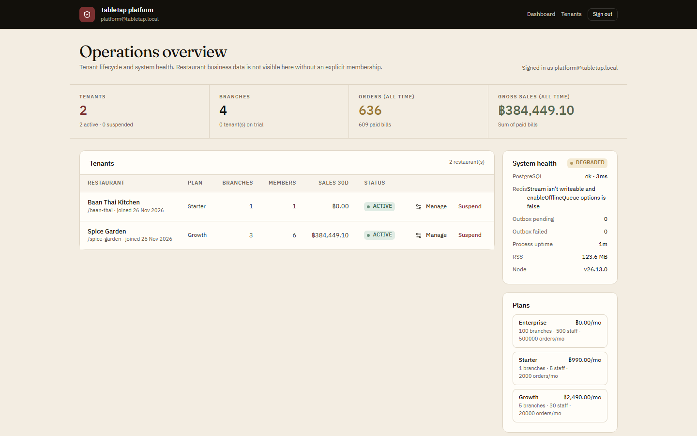 |

Screenshots are captured from the production build with Playwright
(`pnpm screenshots`) against the seeded demo, not mocked up. The script writes
`.screenshots/` and publishes the curated set into `docs/screenshots/`.

---

## Design system

The interface reads as a **service ledger**: the artefacts a restaurant already trusts — the
printed check, the reservation book, the ticket on the pass, the brass rail — rebuilt as a screen
system. Type carries the hierarchy; colour is reserved for state and money.

- **Type** — Fraunces (display) and IBM Plex Sans Thai (UI, Latin + Thai subsets), both
  **self-hosted** in `apps/web/app/fonts` so builds never depend on a network fetch. Money uses
  tabular Plex figures so the `฿` glyph is correct at every size.
- **Palette** — porcelain paper `#f3ede2`, ink `#16130e`, oxblood `#7a3030`, brass `#9a7733`,
  sage `#56674e`, and a near-black `#12100b` for the staff chrome. No purple, no gradient text,
  no glow, no decorative grain.
- **Surfaces** — one declaration per element: a hairline border _or_ a shadow, never both. Radii
  stay between 3px (stamps) and 18px (sheets). Cards are border-only; depth appears only on
  overlays and modals.
- **Layout** — a fixed staff sidebar, a live service rail (tenant · branch · section · clock), a
  horizontal metric band instead of KPI cards, a positioned floor plan drawn from persisted
  coordinates, and a two-column guest ordering surface: the menu on the left, a sticky table rail
  carrying the running order and floor requests on the right.
- **Motion** — scroll reveals via IntersectionObserver, count-up figures, page transitions,
  dialog and sheet entrances. All motion is disabled under `prefers-reduced-motion`.
- **Components** — buttons, inputs, dialogs, tabs, tables, status stamps, metric band,
  empty/skeleton/error states, toast notifications, and permission-aware navigation.

---

## What is implemented

| Area                                      | Status              | Notes                                                                                                        |
| ----------------------------------------- | ------------------- | ------------------------------------------------------------------------------------------------------------ |
| Multi-tenant identity, roles, permissions | **Implemented**     | Permission checks on every request, branch scoping, tenant isolation tested                                  |
| Authentication & sessions                 | **Implemented**     | Argon2id, HttpOnly cookies, refresh rotation with reuse detection, CSRF, lockout, rate limiting              |
| Branches, staff, invitations              | **Implemented**     | Invitation tokens hashed, 7-day expiry, role/branch assignment, immediate revocation                         |
| Tables, zones, floor plan                 | **Implemented**     | Positions persisted, QR tokens encrypted + hashed, rotate/revoke, PNG/SVG labels                             |
| Menu, variants, modifier groups           | **Implemented**     | Per-branch availability, price history, station routing                                                      |
| Guest QR ordering                         | **Implemented**     | Table-scoped session cookie, server-side pricing, idempotent submission, availability re-checked             |
| Kitchen display                           | **Implemented**     | Station tickets, per-item states, reject with reason, live updates + polling fallback                        |
| Billing & split bills                     | **Implemented**     | Snapshotted bills, split equally / by amount / by item, receipts                                             |
| Receipts & printing                       | **Implemented**     | Immutable snapshot, A4 check and 80 mm thermal layouts, browser print; kitchen tickets print from the board  |
| Payments                                  | **Implemented**     | Cash/card recording, PromptPay EMVCo QR, locked confirmation, overpay/duplicate protection, refunds recorded |
| Inventory & recipes                       | **Implemented**     | Atomic once-only deduction on kitchen accept, partial reversal on rejection, full reversal on cancel         |
| Analytics                                 | **Implemented**     | Gross/net sales, payment mix, menu margin, kitchen timings, all from source tables                           |
| Day close & exports                       | **Implemented**     | Bangkok business day, cash collected, open bills, CSV for orders and bills, print view                       |
| Audit log                                 | **Implemented**     | Security and money actions, request IDs, before/after where safe                                             |
| Platform administration                   | **Implemented**     | Tenant lifecycle, suspension revokes sessions, plans, usage, health                                          |
| PWA                                       | **Partial**         | Manifest, icons, offline page, connection banner. No offline ordering (by design)                            |
| Promotions                                | **Implemented**     | Codes with percentage/fixed/coupon value, date window, cap, redemption counter, management UI                |
| Loyalty, shifts, notifications            | **Schema only**     | Tables and seed rows exist; no endpoints or screens                                                          |
| Background worker / BullMQ                | **Not implemented** | Outbox dispatcher runs in-process; Redis is health-checked only                                              |
| File uploads                              | **Not implemented** | Menu images are URL fields; no storage adapter yet                                                           |
| AI assistant, report exports              | **Not implemented** | Deliberately deferred; see roadmap                                                                           |

Full detail: [PROJECT_STATUS.md](./PROJECT_STATUS.md) · [KNOWN_ISSUES.md](./KNOWN_ISSUES.md).

---

## Technology

- **Frontend** — Next.js 15 (App Router), React 19, TypeScript strict, Tailwind CSS v4, Radix UI
  primitives, TanStack Query available, Recharts, Socket.IO client, Zod.
- **Backend** — NestJS 11, Prisma 6, PostgreSQL 16, Socket.IO, Argon2id, class-validator,
  Swagger/OpenAPI, Pino-style structured request logs.
- **Infrastructure** — pnpm workspaces + Turborepo, Docker Compose (Postgres, Redis, Mailpit,
  optional MinIO), GitHub Actions.
- **Testing** — Vitest unit suite, HTTP integration smoke suites for the API and the web app.

---

## Repository layout

```
apps/
  api/          NestJS API + Prisma schema, migration, seed
    src/modules auth, tenancy, catalog, floor, orders, kitchen,
                billing, inventory, analytics, platform, realtime, audit
  web/          Next.js app (staff app, kitchen display, POS, guest menu)
packages/
  shared/       money, permissions, state machines, PromptPay, realtime contract
docs/           architecture, database, api, workflows, security, deployment, operations
tests/load/     k6 scripts (provided, not executed here)
```

---

## Quick start

**Requirements:** Node 20+, pnpm 9+, Docker.

```bash
pnpm install
pnpm demo                     # setup + start: containers, migrations, demo data, API and web
```

`pnpm demo` runs the one-command setup and then `pnpm dev`. If you prefer the steps:

```bash
pnpm bootstrap                    # .env, containers, migrations, demo data (idempotent)
pnpm dev                      # API :4100, web :3100
```

`pnpm bootstrap` is safe to re-run: it reuses containers, applies only pending
migrations and seeds only when the database is empty. To rebuild the demo from
scratch: `pnpm db:reset && pnpm db:seed`.

Open:

- Staff app - <http://localhost:3100/login>
- Guest menu - <http://localhost:3100/menu/demo-sathorn-t03-4f8c2a91>
- API docs - <http://localhost:4100/api/docs>
- Mailpit - <http://localhost:8125>

> The demo seed uses deterministic QR tokens and one shared demo password. Both are development
> only and must never be used in production.

### Demo accounts

Password for every account: `TableTap!2026`

| Email                       | Role                  | Scope                                   |
| --------------------------- | --------------------- | --------------------------------------- |
| `owner@spicegarden.local`   | Owner                 | All three branches, full access         |
| `manager@spicegarden.local` | Manager               | Sathorn + Ari only                      |
| `cashier@spicegarden.local` | Cashier               | Bills, payments, refunds                |
| `kitchen@spicegarden.local` | Kitchen               | Kitchen board only                      |
| `waiter@spicegarden.local`  | Waiter                | Floor, serving, requests                |
| `viewer@spicegarden.local`  | Viewer                | Read-only                               |
| `owner@baanthai.local`      | Owner (second tenant) | Proves isolation                        |
| `platform@tabletap.local`   | Platform admin        | No restaurant data without a membership |

### Try the full flow

1. Sign in as **owner**, open **Floor**, pick a free table, open a session (or scan its QR).
2. Open the guest menu on a phone (or the seeded link), add dishes with modifiers, submit.
3. Open **Kitchen** (or `/kitchen/display` on a tablet) - accept, start, mark ready.
4. In the guest tab, watch the progress; call a waiter or request the bill.
5. Staff see the request in **Guest requests**; acknowledge and resolve it.
6. In **POS**, create the bill, split it, take a payment per share, or take PromptPay: press
   **Generate QR**, then **Simulate provider paid** to send the signed webhook the bank would send.
   Confirm, print the receipt, close the table.
7. **Overview**, **Analytics** and **Day close** now include that bill.

The seeded demo already contains a table mid-service with a split, partially paid bill
(one share PAID, one OPEN), an open bill request, an acknowledged waiter call, a low-stock
alert, a sold-out dish and a historical refund - so every screen has something to show.

---

## Use it from a phone (LAN)

Both apps bind to all interfaces, so any device on the same Wi-Fi can use them. The current machine
is `192.168.1.107`; substitute your own IP if it changes (`ipconfig`).

1. Put the LAN addresses in `.env`:

   ```ini
   WEB_URL=http://192.168.1.107:3100
   CORS_ORIGINS=http://localhost:3100,http://192.168.1.107:3100
   NEXT_PUBLIC_API_URL=http://192.168.1.107:4100
   ```

   The browser socket URL is derived from the page hostname (`lib/socket.ts`), so a phone opening
   `http://192.168.1.107:3100` connects to `http://192.168.1.107:4100` automatically.

2. Allow the ports once (Windows, Private network):

   ```powershell
   New-NetFirewallRule -DisplayName "TableTap Web 3100 (LAN)" -Direction Inbound -Protocol TCP -LocalPort 3100 -Action Allow -Profile Private
   New-NetFirewallRule -DisplayName "TableTap API 4100 (LAN)" -Direction Inbound -Protocol TCP -LocalPort 4100 -Action Allow -Profile Private
   ```

3. Restart the API, then open on the phone:

   - Staff: `http://192.168.1.107:3100/login`
   - Guest: `http://192.168.1.107:3100/menu/demo-sathorn-t03-4f8c2a91`

4. On the computer, open **Kitchen** or `/kitchen/display` and keep it visible. Scan a table QR from
   **Floor → Show QR**; the printed link already uses `WEB_URL`, so it opens on the phone.

Notes:

- Use the **development** API (`NODE_ENV=development`) for plain-HTTP LAN. Production sets `Secure`
  cookies, which a phone will not store over HTTP — put it behind HTTPS.
- The kitchen board shows **Live** when the socket is connected and falls back to polling if not.
- Verify realtime yourself: `pnpm --filter @tabletap/web test:realtime` (connects two real sockets and
  asserts order/kitchen events reach the staff and guest rooms).

---

## Operations

- **Health & metrics** — `GET /api/v1/health` (liveness), `GET /api/v1/health/ready` (PostgreSQL,
  Redis, outbox backlog; `503` when degraded), `GET /api/v1/metrics` (Prometheus text).
- **Backups** — `pnpm backup` writes a gzipped `pg_dump` to `backups/` and keeps the last 14;
  `pnpm restore <file>` restores it. Detail: [docs/operations/backups.md](./docs/operations/backups.md).
- **Monitoring** — scrape config, alert rules and log fields:
  [docs/operations/monitoring.md](./docs/operations/monitoring.md).
- **Printing** — `tools/print-agent` prints kitchen tickets and receipts on an 80 mm ESC/POS printer
  over TCP, with Thai TIS-620 text: [tools/print-agent/README.md](./tools/print-agent/README.md).
- **Realtime at scale** — with `REDIS_URL` set, the Socket.IO gateway attaches the Redis adapter, so
  sockets on every API instance receive the same events.

---

## Verification

Commands below were executed against this repository and the seeded database.

```bash
pnpm --filter @tabletap/api test        # 30 unit tests
pnpm --filter @tabletap/api typecheck
pnpm --filter @tabletap/web build
pnpm lint                               # ESLint 9 flat config, all packages
pnpm --filter @tabletap/api test:integration   # requires API + seed (60+ checks)
pnpm --filter @tabletap/web test:integration   # requires web + seed (24 checks)
pnpm --filter @tabletap/web test:realtime      # two real sockets: staff + guest rooms
pnpm screenshots                               # captures docs/screenshots/*
pnpm backup                                    # pg_dump into backups/
```

> **Do not run `next build` while `next dev` is running.** Both use `apps/web/.next`; the build
> replaces dev artifacts and the dev server then serves stale HTML whose CSS 404s. Stop dev first,
> or use `pnpm build` then `pnpm --filter @tabletap/web start`.

The integration suites assert behaviour, not just status codes: idempotent duplicate orders,
cross-tenant rejection, CSRF rejection, duplicate payment confirmation, stock deduction, PromptPay
payload CRC, split totals, permission denials.

---

## Architecture at a glance

```
Browser ──► Next.js (server components) ──┐
   │                                      ├──► REST /api/v1 ──► NestJS ──► PostgreSQL
   └────────► Socket.IO /realtime ────────┘                      │            (source of truth)
                                                                 ├──► Outbox dispatcher
                                                                 └──► Audit log
```

- **PostgreSQL is authoritative.** Realtime events are notifications, never state.
- **Transactional outbox:** business writes and their events commit together; a dispatcher publishes
  them with a per-tenant sequence so clients can detect gaps and resync over REST.
- **Money is `NUMERIC(12,2)` / `Prisma.Decimal`.** No floating point in any authoritative path.
- **Pricing is server-side.** Client payloads carry item ids and quantities, never prices.
- **Every tenant-scoped query is filtered by the authenticated membership.** Client-supplied tenant
  or branch ids are validated, never trusted.

Deeper: [ARCHITECTURE.md](./ARCHITECTURE.md) · [DECISIONS.md](./DECISIONS.md).

---

## Financial rules (summary)

1. `lineSubtotal = round2((unitPrice + modifiersPerUnit) × quantity)`.
2. Order discounts are allocated across lines proportionally; the remainder goes to the last line so
   allocations sum exactly.
3. Service charge is a percentage of net subtotal or a fixed amount capped at net subtotal.
4. VAT-inclusive: `total = net + service`, tax extracted as `base × rate / (100 + rate)`.
   VAT-exclusive: `tax = base × rate / 100`, added to the total.
5. Tax is computed once on the taxable base and allocated to lines, so
   `sum(line tax) = tax on the bill total`.
6. A bill's totals are the sum of its linked orders' snapshotted totals — a later menu edit cannot
   rewrite history.

Full detail: [docs/architecture/financial-rules.md](./docs/architecture/financial-rules.md).

---

## Payment limitations (important)

- PromptPay QR generation is a **real EMVCo payload** validated with CRC-16/CCITT and known check
  values. It requests money; it does **not** prove money arrived.
- Without a provider, a payment stays `AWAITING_CONFIRMATION` until an authorised cashier confirms
  it. With `PAYMENT_WEBHOOK_SECRET` set, a provider can confirm it by signing a
  `POST /api/v1/public/payments/provider/:provider/webhook` event with HMAC-SHA256; the event is
  stored idempotently before the payment is settled.
- Recording a refund **does not move money**. Staff must complete the transfer with their bank/PSP.
- Receipts are sales receipts, not Thai e-Tax invoices. Fiscal certification is out of scope.

---

## API

REST under `/api/v1`, documented with Swagger at `/api/docs`. Highlights:

```
POST /auth/login | /auth/refresh | /auth/logout | /auth/register
GET  /auth/me | /auth/sessions
GET  /public/qr/:token            POST /public/qr/:token/session
POST /public/customer-session/orders | /requests
GET  /branches/:branchId/tables   POST /tables/:id/open-session | close-session | move | merge
POST /tables/:id/qr | /qr/rotate  GET /tables/:id/qr/download?format=png|svg
GET  /menu/items                  POST /menu/items | /menu/items/:id/availability
GET  /orders                      POST /orders/:id/accept | preparing | ready | served | cancel
GET  /kitchen/tickets             POST /kitchen/tickets/:id/accept | start | ready | reject
POST /bills                       POST /bills/:id/split
POST /payments                    POST /payments/:id/promptpay | confirm | refund
GET  /inventory/ingredients       POST /inventory/receive | adjust | waste | count
GET  /analytics/overview | /sales | /menu-performance | /operations
GET  /platform/dashboard | /tenants | /system-health
```

See [docs/api/endpoints.md](./docs/api/endpoints.md).

---

## Roadmap

1. Promotion management UI + API (engine already applies codes).
2. BullMQ worker for email, payment expiry, exports and alerting; Redis Socket.IO adapter.
3. File storage adapter (S3/MinIO) with signed URLs and image processing.
4. Notifications inbox and delivery channels (email/Telegram/Discord).
5. Shift scheduling, clock-in/out and staff attribution reporting.
6. Report exports (CSV/XLSX/PDF) via background jobs with authorised download URLs.
7. Loyalty programme with consented customer identity.
8. Optional AI summaries over tenant-scoped metrics.
9. Verified PSP integration with webhook signature checks and reconciliation.

---

## License / use

Portfolio and evaluation project. No license is granted for commercial deployment. The demo
credentials and deterministic QR tokens are intentionally public and must be replaced before any
real use.
