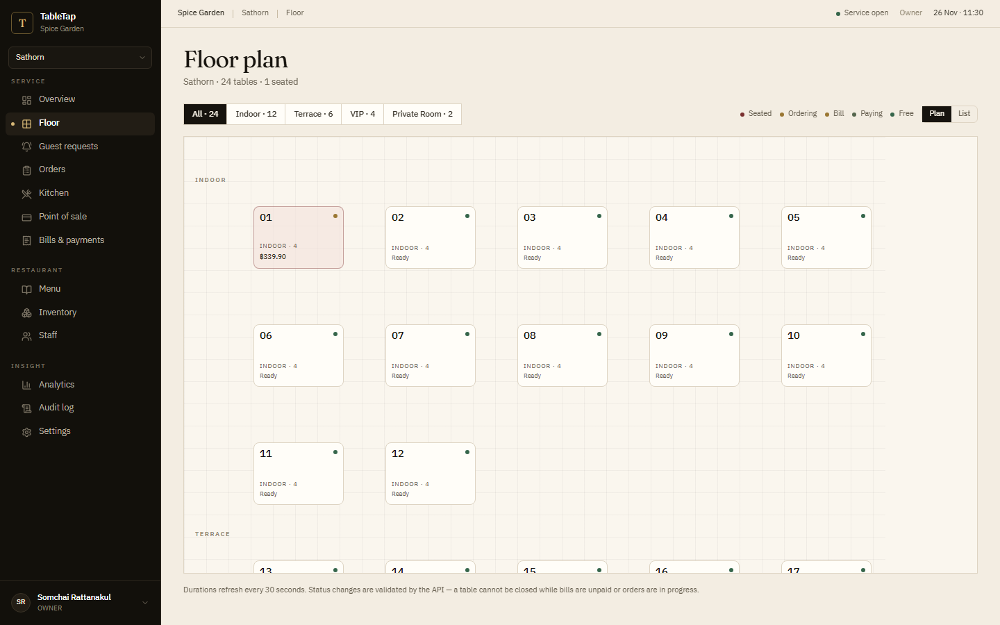
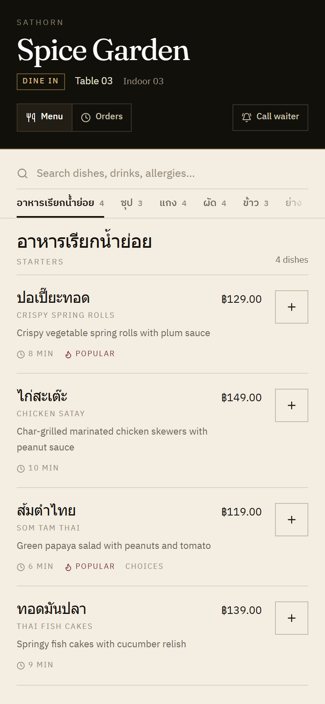
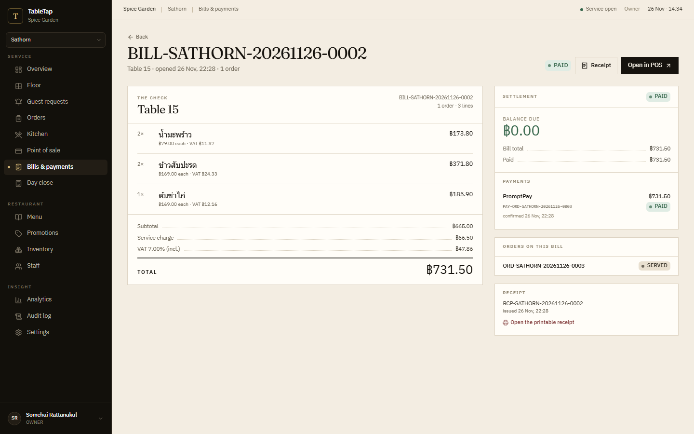
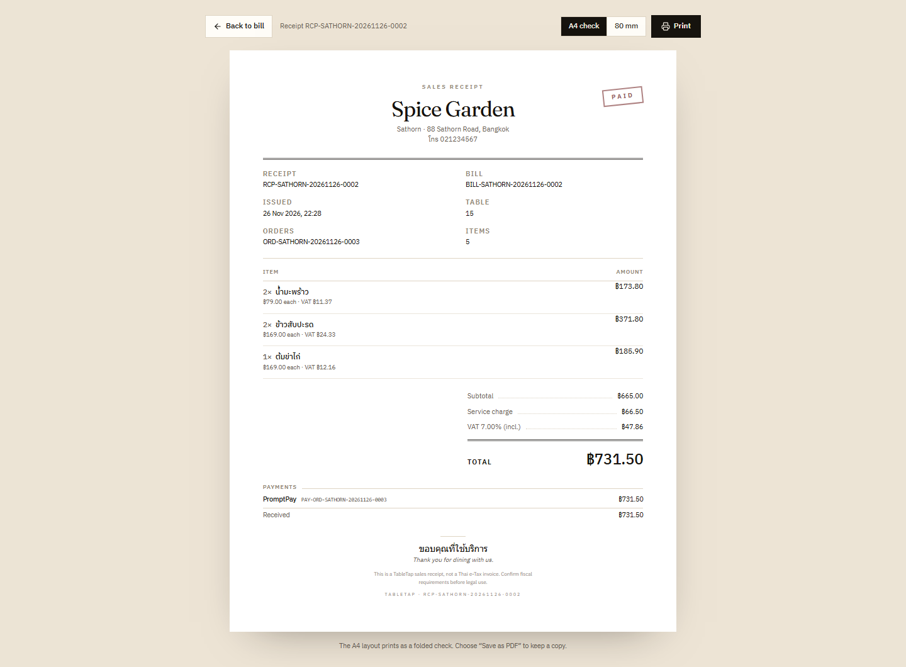
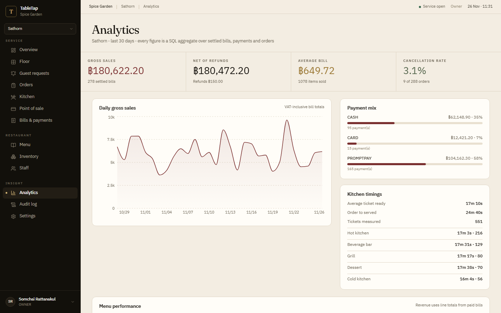

# TableTap

A restaurant system for Thai restaurants: QR ordering at the table, a kitchen board that routes
tickets by station, a cashier POS with PromptPay, and the bills, stock movements, reports and audit
trail that come out of a service.

One deployment hosts several restaurants. Each one has its own branches, staff, menu, tables and
data. The API scopes every query to the signed-in membership, so a manager at one restaurant cannot
read another.

The screenshots below are from the production build against the seeded demo. Every screen reads and
writes the REST API. There is no mock data layer.

## Live demo

<https://tabletap-728.netlify.app>

Sign in as `cashier@spicegarden.local` with `TableTap!2026`, or open table 02 on a phone:
<https://tabletap-728.netlify.app/menu/demo-sathorn-t02-4f8c2a91>.

Netlify hosts the Next.js app. The API, PostgreSQL and WebSockets do not run there, so this demo's API
is served from a development machine behind a Cloudflare tunnel and its database is a separate seed
with a non-payable PromptPay placeholder. The link works while that tunnel is up.
[docs/deployment/netlify.md](docs/deployment/netlify.md) explains the split and how to make it
permanent.

## Screenshots

| Staff overview                               | Floor plan                                     |
| -------------------------------------------- | ---------------------------------------------- |
|  |  |

| Kitchen display                          | POS                              |
| ---------------------------------------- | -------------------------------- |
|  |  |

| Guest menu on a phone                                 | The check                          |
| ----------------------------------------------------- | ---------------------------------- |
|  |  |

| Printable receipt                        | Analytics                                    |
| ---------------------------------------- | -------------------------------------------- |
|  |  |

More in `docs/screenshots/`. They are captured with Playwright from a running build
(`pnpm screenshots`), not mocked up.

The interface uses Fraunces for display type and IBM Plex Sans Thai for UI, both self-hosted. Money
is always tabular. Colour is used for state and money, not decoration.

## What works

- Identity: Argon2id passwords, HttpOnly session cookies, rotating refresh tokens with reuse
  detection, CSRF, login lockout and rate limits.
- Roles and permissions checked per request, with branch scoping. Invitations are hashed, expire in
  seven days and can be revoked.
- Menu with variants, modifier groups, per-branch availability and price history.
- Floor plan with persisted table positions, QR tokens that can be rotated or revoked, and PNG/SVG
  label downloads.
- Guest ordering from a table QR: server-side pricing, idempotent submission, live order progress,
  and waiter, water, utensil and bill requests.
- Kitchen display with station tickets, per-item states, reject with reason, and both live updates
  and a polling fallback.
- Bills built from order snapshots, split equally, by amount or by item, with A4 and 80 mm receipts.
- Payments: cash and card recorded, PromptPay QR, locked confirmation, overpayment and duplicate
  protection, refunds recorded, and split-aware settlement.
- Inventory with recipes. Stock is deducted once when the kitchen accepts an order, reversed on
  rejection or cancellation.
- Analytics, day close for the Bangkok business day, and CSV exports for orders and bills.
- Promotions with percentage, fixed and coupon values, date windows, caps and redemption limits.
- Audit log, platform administration, transactional outbox, Redis-backed realtime, health and
  Prometheus metrics, backups, and an ESC/POS print agent for 80 mm printers.

## What is not built

- Automatic payment verification. A QR requests money; nothing in the app can prove the money
  arrived without a bank or PSP contract. A cashier confirms, or a signed webhook settles it.
- Offline ordering. The PWA caches the shell and shows a connection banner; it does not queue orders
  while the network is down.
- Refunds do not move money. Recording one updates the ledger and the audit log.
- Receipts are sales receipts. They carry VAT lines but are not e-Tax invoices.
- File uploads. Menu images are URLs.
- A background worker. The outbox dispatcher runs inside the API process.
- Loyalty and shift scheduling. Tables and seed rows exist; there are no endpoints or screens.

## Quick start

You need Node 20 or later, pnpm 10 (Corepack is fine) and Docker.

```bash
pnpm install
pnpm demo
```

`pnpm demo` runs `scripts/setup.mjs` and then starts both apps. Setup writes `.env` if it is missing,
starts PostgreSQL, Redis and Mailpit, applies pending migrations, and seeds only when the database is
empty. Running it again reuses the containers and skips the seed.

To set up without starting the apps:

```bash
pnpm bootstrap
pnpm dev
```

Open:

| What       | URL                                                    |
| ---------- | ------------------------------------------------------ |
| Staff app  | <http://localhost:3100/login>                          |
| Guest menu | <http://localhost:3100/menu/demo-sathorn-t02-4f8c2a91> |
| API docs   | <http://localhost:4100/api/docs>                       |
| Mailpit    | <http://localhost:8125>                                |

The demo password for every account is `TableTap!2026`.

| Email                       | Role                 | Scope                                   |
| --------------------------- | -------------------- | --------------------------------------- |
| `owner@spicegarden.local`   | Owner                | All three branches, full access         |
| `manager@spicegarden.local` | Manager              | Sathorn and Ari                         |
| `cashier@spicegarden.local` | Cashier              | Bills, payments, refunds                |
| `kitchen@spicegarden.local` | Kitchen              | Kitchen board                           |
| `waiter@spicegarden.local`  | Waiter               | Floor, serving, requests                |
| `viewer@spicegarden.local`  | Viewer               | Read-only                               |
| `owner@baanthai.local`      | Owner, second tenant | Proves isolation                        |
| `platform@tabletap.local`   | Platform admin       | No restaurant data without a membership |

## The demo scene

The seed leaves the restaurant mid-service, so no screen is empty:

- Table 02 has a split bill with one share paid and one open, an open bill request, and a guest
  session you can open on a phone.
- Table 01 has a water request and a waiter call that a colleague has already acknowledged.
- Forty resolved requests sit behind the history tabs.
- Coconut milk and prawns are below their minimum, so the dashboard and inventory show real low
  stock.
- Mango sticky rice is sold out at Sathorn.
- One historical payment carries a refund.

Table 02 has a balance of ฿347.60, which makes it the useful link for testing payment:

```
http://localhost:3100/menu/demo-sathorn-t02-4f8c2a91
```

Table 03 has no bill and shows the plain ordering flow:

```
http://localhost:3100/menu/demo-sathorn-t03-4f8c2a91
```

## Walk through a service

1. Sign in as the owner and open **Floor**. Pick a free table and open a session, or scan its QR.
2. Open the guest menu on a phone, add a dish with a modifier and send the order.
3. Open **Kitchen** on another screen. Accept the ticket, start it, mark the items ready.
4. The guest tab updates as the kitchen moves. Ask for the bill from **Orders**.
5. Staff see the request in **Guest requests** and resolve it.
6. In **POS**, build the bill and split it if you like. Take cash, or press **Generate QR** for
   PromptPay. Confirm once the money is in, print the receipt, then close the table.

The bill, the stock movements, the receipt snapshot and the day-close figures all come from the same
rows you just created.

## PromptPay

A PromptPay QR from the POS or the guest menu is a real EMVCo payload with the amount and a
reference, validated with CRC-16/CCITT. Any Thai banking app will read it and move money to the
account configured for the branch.

The app cannot see that transfer. Without a bank or PSP contract there is no API to ask, so a payment
stays `AWAITING_CONFIRMATION` until a cashier confirms it. The POS button **Simulate provider paid**
signs a webhook body and posts it to the real webhook endpoint, which is the path a provider would
use. That keeps the demo honest about where the confirmation comes from.

Two things worth knowing:

- The payer's bank shows the name registered against the PromptPay ID, not the display name in
  Settings. Keep them the same.
- The seed reads `DEMO_PROMPT_PAY_ID` and `DEMO_PROMPT_PAY_NAME` from `.env`. Without them it seeds
  `0000000000000`, a placeholder no bank will pay, so a public clone cannot send money to a stranger
  by accident. Put your own account in Settings to take real payments.

## Architecture

```
              +-------------------------------+
Browser ----> | Next.js (server + client)     |
              +---------------+---------------+
                              | REST /api/v1, cookies + CSRF
                              v
              +-------------------------------+
              | NestJS API, one module per    |
              | domain                        |
              +------+----------------+-------+
                     |                |
                     v                v
               PostgreSQL        Redis (optional)
               source of truth   socket adapter, health
                     |
                     +--> audit log
                     +--> outbox --> /realtime
```

- PostgreSQL is authoritative. Realtime events are notifications; clients resync over REST when they
  detect a gap in the per-tenant sequence.
- Business writes and their events commit together in an outbox, then a dispatcher publishes them.
- Money is `NUMERIC(12,2)` and `Prisma.Decimal` from the database to the UI. No floats.
- Prices come from the server. Client payloads carry item ids and quantities, never amounts.
- Tenant and branch ids from the client are validated against the membership, never trusted.

## Money rules

1. `lineSubtotal = round2((unitPrice + modifiersPerUnit) * quantity)`.
2. Order discounts are allocated across lines proportionally; the remainder goes to the last line so
   the allocations add up exactly.
3. Service charge is a percentage of the net subtotal, or a fixed amount capped at the net subtotal.
4. VAT-inclusive: `total = net + service`, tax extracted as `base * rate / (100 + rate)`.
   VAT-exclusive: `tax = base * rate / 100` and added to the total.
5. Tax is computed once on the taxable base and then allocated to lines, so the line taxes sum to the
   tax on the bill total.
6. A bill totals its linked order snapshots. Editing the menu later cannot rewrite history.

The full rules, including rounding and refunds, are in
[docs/architecture/financial-rules.md](docs/architecture/financial-rules.md).

## Repository layout

```
apps/
  api/       NestJS API, Prisma schema, migrations and seed
  web/       Next.js app: staff app, kitchen display, POS, guest menu
packages/
  shared/    money, permissions, state machines, PromptPay, realtime contract
tools/
  print-agent/   ESC/POS agent for 80 mm kitchen tickets and receipts
tests/
  load/      k6 scripts
docs/        architecture, database, API, workflows, security, deployment, operations
scripts/     setup, screenshots, backup
```

## Commands

| Command              | What it does                                                 |
| -------------------- | ------------------------------------------------------------ |
| `pnpm demo`          | Set up the environment, then run the API and the web app     |
| `pnpm bootstrap`     | Set up only: `.env`, containers, migrations, seed when empty |
| `pnpm dev`           | Run both apps (API on 4100, web on 3100)                     |
| `pnpm build`         | Build every package                                          |
| `pnpm lint`          | ESLint 9 flat config, all packages                           |
| `pnpm typecheck`     | TypeScript with no emit                                      |
| `pnpm test`          | Unit tests                                                   |
| `pnpm test:api`      | HTTP smoke against a running API and the seed                |
| `pnpm test:web`      | Server-rendered checks against a running web app             |
| `pnpm test:realtime` | Two real sockets, staff and guest rooms                      |
| `pnpm db:reset`      | Drop and recreate the schema                                 |
| `pnpm db:seed`       | Load the demo data                                           |
| `pnpm db:studio`     | Prisma Studio                                                |
| `pnpm screenshots`   | Capture `docs/screenshots/` from a running build             |
| `pnpm backup`        | `pg_dump` into `backups/`, keeping the last 14               |
| `pnpm restore`       | Restore a backup                                             |
| `pnpm print:agent`   | Run the ESC/POS print agent                                  |

Stop the API before `pnpm db:reset`. PostgreSQL will otherwise keep prepared plans for tables that no
longer exist and return `cached plan must not change result type` until the API reconnects.

## Tests

- Unit (30): pricing, splits, state machines and the PromptPay payload with known check values.
- API smoke: real HTTP with real cookies and CSRF headers. Duplicate orders stay single, duplicate
  confirmations are rejected, cross-tenant reads fail, stock is deducted once, split totals keep the
  satang, and the PromptPay payload parses as EMVCo with THB and the amount.
- Web smoke (24): server-rendered pages for each role, including access denials.
- Realtime: two sockets, one staff and one guest, assert order and kitchen events arrive and that
  resync returns the missed events.

CI runs the whole set on every pull request against a real PostgreSQL service and the actual servers.

## Documentation

| Document                                                                     | Contents                                  |
| ---------------------------------------------------------------------------- | ----------------------------------------- |
| [ARCHITECTURE.md](ARCHITECTURE.md)                                           | System shape, tenancy, money, realtime    |
| [DECISIONS.md](DECISIONS.md)                                                 | Fourteen decision records with trade-offs |
| [PROJECT_STATUS.md](PROJECT_STATUS.md)                                       | What is implemented, partial or missing   |
| [KNOWN_ISSUES.md](KNOWN_ISSUES.md)                                           | Known gaps and their intended fixes       |
| [docs/api/endpoints.md](docs/api/endpoints.md)                               | Endpoint reference                        |
| [docs/architecture/financial-rules.md](docs/architecture/financial-rules.md) | Rounding, tax, splits, refunds            |
| [docs/security/security-model.md](docs/security/security-model.md)           | Threat model and controls                 |
| [docs/operations/runbook.md](docs/operations/runbook.md)                     | Day-two operations                        |
| [docs/deployment/production.md](docs/deployment/production.md)               | Production setup                          |
| [docs/deployment/netlify.md](docs/deployment/netlify.md)                     | The Netlify split and its limits          |

## Using it from a phone

Both apps listen on all interfaces. On the same Wi-Fi, a phone can use the machine's LAN address.

1. Put the address in `.env`:

   ```ini
   WEB_URL=http://192.168.1.107:3100
   CORS_ORIGINS=http://localhost:3100,http://192.168.1.107:3100
   NEXT_PUBLIC_API_URL=http://192.168.1.107:4100
   ```

2. Allow the two ports on the private network (Windows):

   ```powershell
   New-NetFirewallRule -DisplayName "TableTap Web 3100 (LAN)" -Direction Inbound -Protocol TCP -LocalPort 3100 -Action Allow -Profile Private
   New-NetFirewallRule -DisplayName "TableTap API 4100 (LAN)" -Direction Inbound -Protocol TCP -LocalPort 4100 -Action Allow -Profile Private
   ```

3. Restart the apps and open `http://192.168.1.107:3100/login` on the phone.

Use `NODE_ENV=development` for plain HTTP on a LAN. Production cookies are `Secure` and a phone will
not store them over HTTP, so put the app behind HTTPS.

## License

No license is granted. The demo credentials, QR tokens and PromptPay account are development
fixtures and must be replaced before any real use. If you want to reuse the code, ask first.
